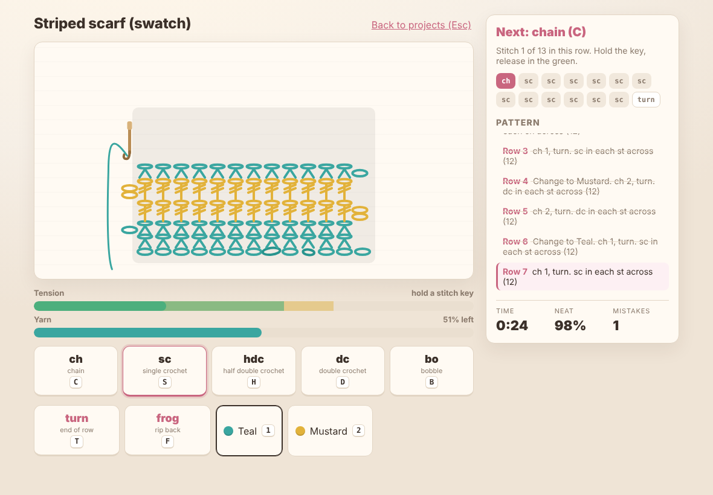

# Hooked: a crochet game (prototype)

A small browser game about crochet. You are handed a written pattern, a hook and a ball of yarn, and you work the piece stitch by stitch. Hold each stitch key to pull the loop through: release in the green zone for a neat stitch, too soon and it is loose, too long and it is tight. Loose stitches waste yarn, wrong stitches must be frogged (ripped back) before you can carry on, and the finished piece is graded on neatness, mistakes and time.

No build step, no dependencies. Open `index.html` from any static server.



## Play it

```sh
npx serve .          # or: python3 -m http.server 8000
```

Then open the printed URL. The page is ES modules, so it needs to be served over HTTP rather than opened as a `file://` URL.

### Controls

| Key | Action |
| --- | --- |
| `C` `S` `H` `D` `B` | Hold to make a chain, single crochet, half double, double, or bobble. Release in the green. |
| `T` or `Enter` | Turn the work at the end of a row, or fasten off on the last row. |
| `1` `2` | Change yarn when the pattern says to. |
| `F` or `Backspace` | Frog: rip back the last stitch of the current row. Also removes a wrong stitch. |
| `M` | Toggle sound. |
| `Esc` | Back to the project list. |

The on-screen buttons do the same thing with mouse or touch (press and hold the stitch buttons).

### Projects

| Project | Teaches |
| --- | --- |
| Mug coaster | Chains and single crochet, holding tension. |
| Striped scarf (swatch) | Yarn changes, double crochet rows with a two-chain turn. |
| Bobble pouch panel | Bobbles, which cost a lot of yarn, so loose stitches will run you short. |

Best results are kept per project in `localStorage`.

## How it is put together

```
index.html        markup for the three screens
css/style.css     styling
js/patterns.js    stitch table, the pattern mini-language, the three patterns (pure)
js/game.js        rules: tension from hold time, yarn, frogging, scoring (pure)
js/render.js      canvas layout and stitch drawing
js/main.js        DOM, keyboard/pointer input, audio, animation loop
test/             node:test suites for the two pure modules
scripts/smoke.mjs headless Chromium run-through that plays a whole project
```

### Pattern mini-language

A row is a short string: `ch sc*8` is a turning chain then eight single crochet, `ch sc [bo sc*2]*3` repeats a group. `buildSteps()` turns a pattern into the ordered list of player actions (yarn change, stitch, turn, fasten off), which is what the game and the UI both run on. Adding a pattern is adding an entry to `PATTERNS`.

### Tension

`tensionFromHold(ms)` maps hold time to a tension value in `[-1, 1]` and a quality label. The centre and zone widths live in `HOLD`; the on-screen meter reads them, so changing the numbers changes the game and the UI together. Stitches are drawn wider and looser or narrower and tighter by that value, so a sloppy row looks sloppy.

## Tests

```sh
npm test                       # node:test, no dependencies
node scripts/smoke.mjs         # needs playwright + Chromium; writes docs/*.png
```

## Ideas not in the prototype

- Rounds (granny squares, amigurumi) rather than only flat rows.
- Increases and decreases, so shapes can change width.
- A rhythm element: a metronome that rewards an even pace across a row.
- Unlocks: finishing a project unlocks the next yarn colour or hook.
- Export the finished piece as an image.

## Licence

MIT, see `LICENSE`.
