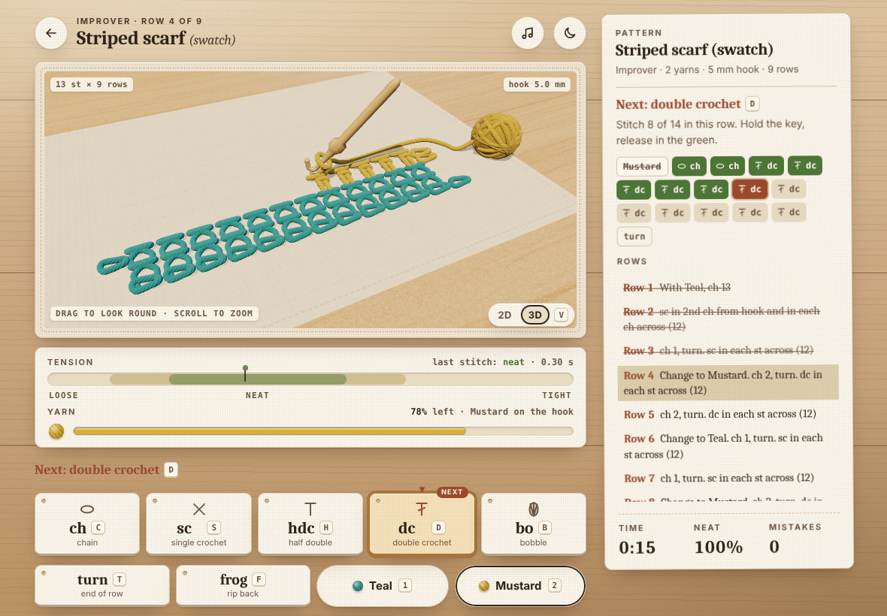

# Hooked: a crochet game (prototype)

A small browser game about crochet. You are handed a written pattern, a hook and a ball of yarn, and you work the piece stitch by stitch. Hold each stitch key to pull the loop through: release in the green zone for a neat stitch, too soon and it is loose, too long and it is tight. Loose stitches waste yarn, wrong stitches must be frogged (ripped back) before you can carry on, and the finished piece is graded on neatness, mistakes and time.

The work can be watched as a flat chart (2D canvas) or lying on the table in 3D (three.js, vendored); press `V` to switch.

No build step, no dependencies, nothing fetched from a CDN. Open `index.html` from any static server.


## Play it

```sh
npx serve .          # or: python3 -m http.server 8000
```

Then open the printed URL. The page is ES modules, so it needs to be served over HTTP rather than opened as a `file://` URL.

### Controls

| Key | Action |
| --- | --- |
| `C` `S` `H` `D` `B` | Hold to make a chain, single crochet, half double, double, or bobble. Release in the green. |
| `T` or `Enter` | Turn the work at the end of a row, or fasten off on the last row. |
| `1` `2` | Change yarn when the pattern says to. |
| `F` or `Backspace` | Frog: rip back the last stitch of the current row. Also removes a wrong stitch. |
| `V` | Switch the work between the 2D chart and the 3D table. The choice is remembered. |
| `M` | Toggle sound. |
| `N` | Toggle the day / night (lamp-lit) theme. The choice is remembered. |
| `Esc` | Back to the project list. |

The on-screen buttons do the same thing with mouse or touch (press and hold the stitch buttons; the `2D | 3D` switch sits in the mat's bottom-right corner). In 3D, drag on the mat to look round the work and scroll or pinch to zoom.

### Projects

| Project | Teaches |
| --- | --- |
| Mug coaster | Chains and single crochet, holding tension. |
| Striped scarf (swatch) | Yarn changes, double crochet rows with a two-chain turn. |
| Bobble pouch panel | Bobbles, which cost a lot of yarn, so loose stitches will run you short. |

Best results are kept per project in `localStorage`, with the theme (`hooked.theme`) and the view (`hooked.view`).

## The 3D view



The 3D view is another view of the same game, not a different game: the keys, meters, next strip and pattern leaflet are unchanged, and only the mat shows something else. The fabric lies on a linen blocking mat on the table, the ball sits on the mat to the right, and the hook stands in the top loop of the last stitch made, exactly where the 2D chart puts it (so a wrong stitch is on the hook, and frogging pulls the hook back a stitch). Each stitch is a yarn tube built from the same layout as the 2D chart, so the two views always agree on where every stitch is. Loose, tight and wrong stitches look different, as in 2D. A wrong stitch is red and striped with a pin in it. The night theme puts the table under a lamp. In the game the camera is close enough that the row being worked fills about 60% of the mat, and it pans on to each new row as the work is turned; the ball moves up beside the row being worked, so it stays in frame and its shrinking still warns you before the yarn runs out. The whole piece comes back into view for the completion turntable.

- **Loaded only when asked for.** `js/main.js` imports `js/view3d.js` (and with it three.js) the first time the player picks 3D, then mounts it over the mat, in the same space as the 2D canvas. Its start is split over several tasks (scene, shader compile, texture uploads), and 2D stays on the mat until it is ready (`view.ready`). While the 3D view is up, the 2D canvas is hidden and not drawn. The 3D view is stepped on every animation frame but only draws when something changed (a move, a hold, a stitch growing in, the camera, an effect), and not at all while the mat is scrolled off screen. Phones and tablets get a capped pixel ratio that steps down (1.5, 1, 0.75) while frames run slow, no MSAA, cheaper materials and shadows; the tension meter runs as a compositor animation, so it stays smooth even when a 3D frame is slow. It is freed (geometries, textures, the WebGL context) when the player leaves the play screen.
- **Only where it can run.** If the browser has no WebGL, the `2D | 3D` switch is hidden and the game stays 2D.
- **Showcase page.** `3d.html` (linked from the title screen as *3D showcase*) plays a pattern by itself on a full-window table. Keys: `1` to `3` pick a pattern, `N` lamp, `R` turntable, `Space` pause. URL parameters: `pattern=coaster|scarf|pouch`, `theme=light|dark`, `autoplay=0|1`, `speed=fast|slow`, `seed`.

```js
import { createView3D, supportsWebGL } from './js/view3d.js';
if (supportsWebGL()) {
  const view = createView3D(container, {   // container: positioned, with a definite height
    game,                                   // a Game from js/game.js
    getHold: () => (held ? { progress, zone } : null), // progress 0..1 and the tension zone while a key is held
    theme: 'auto',                          // follows data-theme on <html> and prefers-color-scheme
    framing: 'fit',                         // 'fit' for a small frame (the mat), 'brief' for a big stage
  });
  await view.ready;   // shaders compiled and textures uploaded (optional: update() works before, but stalls)
  view.update();      // once per animation frame while visible; draws only if something changed
  view.setGame(game); // a new project; also view.resize(), view.setCamera({...}), view.invalidate(), view.dispose()
}
```

### Vendored three.js

`vendor/three/` holds three.js **r160** (`three.module.min.js` and `OrbitControls.js`, MIT, from the `three@0.160.0` npm package; licence in `vendor/three/LICENSE`). The `OrbitControls` import was rewritten to point at the local module, so the game never needs a CDN or a bundler. To upgrade, replace both files from the same npm version and keep that import pointing at `./three.module.min.js`.

## How it is put together

```
index.html            markup for the three screens
3d.html               3D showcase: a pattern worked by itself on the table
css/style.css         styling (tokens from docs/design-tokens.css)
js/patterns.js        stitch table, the pattern mini-language, the three patterns (pure)
js/game.js            rules: tension from hold time, yarn, frogging, scoring (pure)
js/render.js          2D canvas layout and stitch drawing (layout() is shared with 3D)
js/main.js            DOM, keyboard/pointer input, audio, animation loop, 2D | 3D switch
js/view3d.js          the 3D view: scene, lights, camera, hook, loop, ball, stitch meshes
js/view3d/            stitch tube paths and the procedural textures (yarn, wood, linen, bamboo)
vendor/three/         three.js r160 + OrbitControls, vendored
test/                 node:test suites for the two pure modules
scripts/smoke.mjs     headless Chromium: plays a whole project, then a game in 3D
scripts/shots2d.mjs   screenshots of the 2D game (docs/visuals/2d-*.png) and the social card
scripts/og-card.html  the 1200 x 630 social preview (docs/visuals/og-card.png), drawn with render.js
scripts/shots3d.mjs   3D renders, turntable mp4/gif and numeric checks (docs/visuals/3d-*)
docs/design-brief.md  the design brief both views were built to
docs/design-board.html the visual direction on one page: palette, type, live stitch glyphs, every UI state, 3D, v0.1 → now
scripts/shots-board.mjs full-page capture of the design board (docs/visuals/design-board.png) and its checks
```

### Pattern mini-language

A row is a short string: `ch sc*8` is a turning chain then eight single crochet, `ch sc [bo sc*2]*3` repeats a group. `buildSteps()` turns a pattern into the ordered list of player actions (yarn change, stitch, turn, fasten off), which is what the game and the UI both run on. Adding a pattern is adding an entry to `PATTERNS`.

### Tension

`tensionFromHold(ms)` maps hold time to a tension value in `[-1, 1]` and a quality label. The centre and zone widths live in `HOLD`; the on-screen meter reads them, so changing the numbers changes the game and the UI together. Stitches are drawn wider and looser or narrower and tighter by that value, so a sloppy row looks sloppy.

## Tests

```sh
npm test                       # node:test, no dependencies
node scripts/smoke.mjs         # needs playwright + Chromium; writes docs/*.png and docs/visuals/game-3d.png
node scripts/shots2d.mjs       # optional: [desktop|phone|cards|fabric|oops|landscape|og]; writes docs/visuals/2d-*.png, og-card.png (~3 min)
node scripts/shots3d.mjs       # optional: 3D renders + turntable (needs ffmpeg; ~8 min under SwiftShader)
node scripts/shots-board.mjs   # optional: the design board at 1180 wide (--dark, --width=390); checks pictures, glyphs, tokens, no sideways scroll
```

Set `CHROMIUM_PATH` to a Chromium binary if Playwright's own is not installed. The smoke test plays the striped scarf in 2D with one wrong stitch, one loose and one tight. It opens every project at 360, 375 and 390 px wide and narrows a laptop window to 390 px mid-game, and fails if the page scrolls sideways or any control (mat, sound button, last stitch key, yarn buttons, `2D | 3D` switch) runs past the right gutter (`body` clips overflow, so it measures the elements, not just the page). On touch phones held sideways (568 x 320 up to 956 x 440) the next strip and every key must end above the fold, and pressing `Esc` in the moment before the completion card appears must leave the title screen clean. Then it runs a second, WebGL-enabled Chromium (SwiftShader). That run switches a scarf in progress to 3D with `V` and checks the three.js canvas, that the view follows play and that the choice is remembered (its key holds carry their own timestamps, so the README's 3D image is a neat game however loaded the machine is). It also checks that `V` goes back to 2D, that leaving the play screen disposes the view, and the phone layout in 3D. `shots3d.mjs` also fails if the rows do not stack straight, the stripes come out of order, the hook is not where `render.js` puts it (the last stitch's top loop), the working loop hides the crook, a yarn renders more than 15° of hue from its token, the dark mat falls under 0.8x the `--surface-2` luminance or the room behind it turns cool, or the row being worked in the game spans less than 55% of the mat. It also checks that at least 70% of the crook is in view (not behind the loop or the stitches), and that the ball stays inside the frame and clear of the mat's labels at rows 2, 5 and 9 of the game and all the way round the turntable. `shots2d.mjs` fails if a plank seam of the tabletop crosses a line of text on the wood (`main.js` slides the seams into the gaps between lines), if its clean scarf (every stitch held into the green, the run of neat stitches and the completion card in the gallery) does not come out A+ in three tries, or if the social card's tagline wraps or anything on it leaves the frame or runs into the swatch.

## Ideas not in the prototype

- Rounds (granny squares, amigurumi) rather than only flat rows.
- Increases and decreases, so shapes can change width.
- A rhythm element: a metronome that rewards an even pace across a row.
- Unlocks: finishing a project unlocks the next yarn colour or hook.
- Export the finished piece as an image.

## Licence

MIT, see `LICENSE`.
